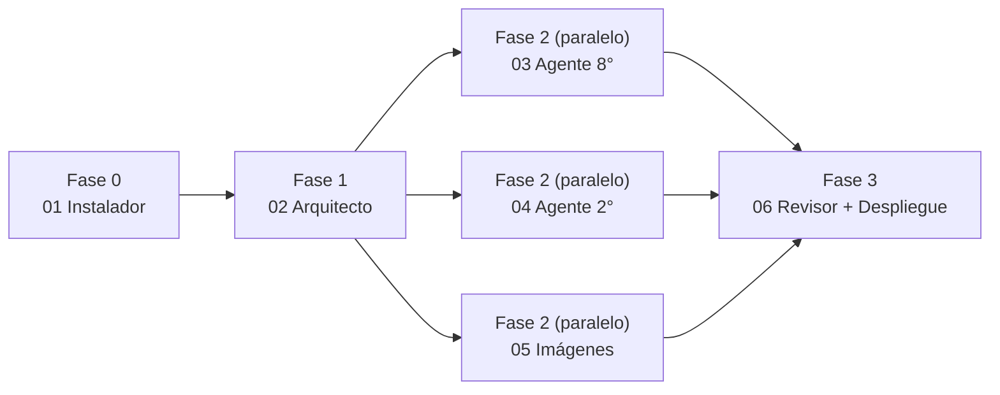

# 00 · Orden general del trabajo (documento del Jefe)

Este es el documento maestro. **Todo agente lo lee completo antes de su propio brief.**

## Objetivo

Reestructurar la plataforma en **dos inducciones**, cada una con 2 clases de 90 minutos:

| Inducción | Público | Contenido | Decisión final |
|---|---|---|---|
| **8° Básico** | Alumnos de 8° | Todo lo que existe hoy (electrónica, 3D, manufactura, IA, radar) + un **resumen corto** de drones | ¿Entro a **Geogo en 1° Medio**? |
| **2° Medio** | Alumnos de 2° Medio | **Solo drones / Geomática a fondo** (lo de 3° y 4° Medio), incluida **Topografía en 4° Medio** | ¿Sigo la senda en **3° y 4° Medio**? |

Repositorio: `https://github.com/ProfChristopherR/inducciongeogo` (el antiguo `induccion2medio` fue renombrado; ya no existe).
Web: `https://profchristopherr.github.io/inducciongeogo/`

## Orden de ejecución



| Fase | Agente | Brief | Empieza cuando |
|---|---|---|---|
| 0 | Instalador | [01_AGENTE_INSTALADOR.md](01_AGENTE_INSTALADOR.md) | El Jefe da la orden |
| 1 | Arquitecto | [02_AGENTE_ARQUITECTO.md](02_AGENTE_ARQUITECTO.md) | Fase 0 marcada ✅ en `ESTADO.md` |
| 2 | Agente 8° Básico | [03_AGENTE_OCTAVO.md](03_AGENTE_OCTAVO.md) | Fase 1 ✅ |
| 2 | Agente 2° Medio | [04_AGENTE_SEGUNDO.md](04_AGENTE_SEGUNDO.md) | Fase 1 ✅ |
| 2 | Imágenes | [05_AGENTE_IMAGENES.md](05_AGENTE_IMAGENES.md) | Fase 1 ✅ |
| 3 | Revisor + Despliegue | [06_AGENTE_REVISOR_DESPLIEGUE.md](06_AGENTE_REVISOR_DESPLIEGUE.md) | Las tres de Fase 2 ✅ |

Ningún agente empieza antes de que su fase previa esté marcada ✅ en [ESTADO.md](ESTADO.md).

## Reglas para todos

1. **Propiedad de archivos.** Cada agente solo edita los archivos que su brief le asigna. Si necesita un cambio en un archivo ajeno, lo anota en la sección "Pedidos" de `ESTADO.md` y sigue con lo suyo. El Jefe resuelve.
2. **Git: solo el agente 06 hace commit y push.** Los demás no ejecutan `git commit`, `git push` ni `git checkout`.
3. **Windows / PowerShell:** usar siempre `npm.cmd` y `npx.cmd` (`npm.ps1` está bloqueado).
4. **Red:** `git clone`, `npm install` y `git push` necesitan salir del sandbox. Todo lo demás (build, lectura, edición) va dentro del sandbox.
5. **Al terminar**, cada agente:
   - ejecuta `npm.cmd run build` y confirma 0 errores (salvo Fase 0, que no toca código);
   - marca su fila ✅ en `ESTADO.md` y escribe un resumen de 3–6 líneas: qué hizo, qué quedó pendiente y qué decidió.
6. **No inventar datos técnicos.** Normativa DGAC, especificaciones de drones y cifras deben ser correctas o ir marcadas como aproximadas. Si hay duda, se escribe en "Pedidos".
7. **Idioma:** todo el texto visible va en español de Chile, claro y legible en proyector.
8. **No perder contenido.** Lo que hoy existe se mueve, no se borra, salvo que el brief diga explícitamente que se elimina.

## Estándar visual (no negociable)

- Estilo Apple / glassmorphism ya implementado: clases `apple-glass`, `apple-glass-subtle`, `apple-glass-dark`, `apple-pill` en `src/index.css`.
- Transiciones `framer-motion` con fade + blur suave (ver `src/App.tsx`).
- Lo visual domina (imágenes, 3D, simulaciones) y el texto acompaña. Mínimo 14 px en texto de lectura y títulos grandes para proyector.
- 3D realista y con detalle (ver `CircuitLab3D.tsx` y `Parametric3DLab.tsx` como piso de calidad). **Prohibido** volver a primitivas simples "de niño".
- Navegación lineal por estaciones (← / → y dock inferior). No es una web de navegación libre.
- Usar las skills instaladas en Fase 0: **impeccable**, **taste-skill**, **emil-skills** (y `elephant-goldfish-model` solo si el Instalador confirma que aplica).

## Contrato técnico compartido (lo crea el Arquitecto, los demás lo respetan)

```ts
// src/tracks/types.ts
export type TrackId = 'octavo' | 'segundo'
export type ClassId = 'class-1' | 'class-2'

export interface StationDef {
  id: string              // único dentro de la clase, ej. 'ohm-lab'
  title: string           // corto, se muestra en el header y en el dock
  minutes: string         // ej. "00' - 20' min"
  Component: React.ComponentType
}

export interface ClassDef {
  id: ClassId
  label: string           // ej. 'Clase 1: Electrónica y 3D'
  durationMin: number     // 90
  stations: StationDef[]
}

export interface TrackDef {
  id: TrackId
  label: string           // '8° Básico' | '2° Medio'
  tagline: string
  decisionQuestion: string
  heroMediaKey: string    // clave de MEDIA_CATALOG
  classes: [ClassDef, ClassDef]
}
```

- `src/tracks/octavo/index.ts` exporta `octavoTrack: TrackDef` (dueño: Agente 8°).
- `src/tracks/segundo/index.ts` exporta `segundoTrack: TrackDef` (dueño: Agente 2°).
- `src/tracks/registry.ts` exporta `TRACKS: Record<TrackId, TrackDef>` (dueño: Arquitecto).
- El store, el header y el navegador leen el número de estaciones desde el registro. **Nada de límites fijos** como el `5 : 7` actual.

## Cómo lanza el Jefe a los agentes (cuando el profesor lo autorice)

Cada agente recibe este prompt:

> Eres el agente `<NN>` del proyecto en `c:\Users\Dairo\OneDrive\Documents\Proyectos\LiceoSN\induccion-geogo`. Lee primero `docs/orquestacion/00_JEFE_ORQUESTACION.md`, luego `docs/orquestacion/<tu brief>.md` y `docs/orquestacion/ESTADO.md`. Ejecuta solo tu brief. Al terminar, actualiza `ESTADO.md` y avísale al Jefe.

